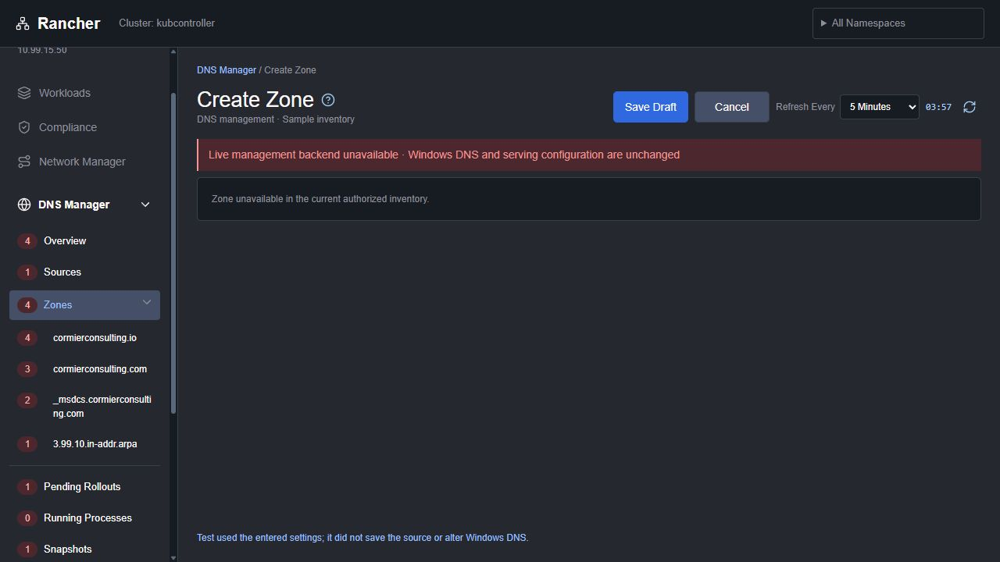

# DNS Manager standards audit — 2026-10-11

The DNS preview follows much of the common shell and safe local-draft behavior, but it does **not** meet the full plugin standard. The most immediate defects are a broken Create Zone page, non-resumable incomplete drafts, ignored refresh results, missing snapshot-coverage UI, inconsistent snapshot styling, and poor allocation of content space at smaller sizes.

The review and remediation plan are complete. Product repairs and production/native acceptance are future work; this report does not claim those features were implemented.

## Complete requirement coverage

[CHECKLIST.md](CHECKLIST.md) records the requirement text, standard line, result, analysis and evidence **for every item**. [requirements.json](requirements.json) supplies the same information in machine-readable form, pinned to the standard's SHA-256. There are 231 items: 9 source references, 198 shared rules and 24 acceptance checklist entries. Narrative sections 11, 12 and 14 are also analyzed. Historical appendices are treated as prior evidence, not current acceptance.

| Disposition | Items | Meaning |
|---|---:|---|
| Verified local | 65 | Only the stated local UI or local backend behavior was demonstrated |
| Partial | 113 | Some behavior works; the row identifies the missing part |
| Gap | 31 | A required behavior is absent or contradicted |
| Unverified live | 8 | Requires native Rancher/backend/managed-service acceptance |
| Not applicable | 5 | DNS-specific reason provided |
| Context | 9 | Reference material rather than an implementation assertion |

These are requirement dispositions, not independent test counts. A partial or unverified row is not a compliance pass.

[STANDARD-SNAPSHOT.md](STANDARD-SNAPSHOT.md) preserves the exact reviewed standard so subsequent changes do not invalidate this report's context. Its original relative links resolve from the repository root.

The accepted Network Manager navigation variation in section 2 applies to that plugin. DNS still follows the shared navigation requirements; this audit does not treat Network's native right-aligned menu exception as a DNS exception. The Network audit reference added in section 1 is context, not DNS acceptance evidence.

## Findings and repair priorities

| ID | Priority | Finding and analysis | Evidence / acceptance requirement |
|---|---|---|---|
| F01 | P1 | **Create Zone is broken.** `render()` checks `page.startsWith('zone:')` before the new-zone editor. `zone:new` renders “Zone unavailable” with Save Draft/Cancel but no form. | [Screenshot](screenshots/29-zone-create.png), `ui/dns-manager.js` render/editor; RPD-06-02; failing UI test |
| F02 | P1 | **Incomplete drafts cannot be resumed.** Save Draft And Leave persists `needsCompletion:true`, but Pending displays “Draft · Not Applied” for every draft. Overview shows a number with no Resume action. Working drafts and validated proposals are not separate states. | [Pending](screenshots/30-pending-incomplete.png), [review JSON](screenshots/31-pending-review.png), [Overview](screenshots/36-overview-lower.png); RPD-05-05, 06-09, 07-01/02 |
| F03 | P1 | **Refresh does not update inventory.** `onReady` displays a notice and discards observation results; source/zones/records remain initial clones. The native route supplies no datasource/read provider. Header Refresh also does not reload snapshot history, storage or schedules. Snapshot fetches bypass the bounded request controller. | `ui/dns-manager.js`, `ui/request-state.js`, `routing.js`, `snapshot-feature/data/*`; RPD-09-04/06, 10-14; failing observation readback test |
| F04 | P2 | **Domain filters are single selects.** Type, log source and severity lack searchable multiple selection, selected counts and clear controls. Snapshot generation is only a keyword, not a Manual/Automatic filter. The global namespace picker is substantially closer to the standard. | [Records](screenshots/04-zone-io.png), [Diagnostics](screenshots/22-diagnostics.png), [Snapshots](screenshots/17-snapshots-populated.png); RPD-04-05/06/07, 08-11 |
| F05 | P2 | **Read-only details and resource navigation are incomplete.** Source names open Edit; record text has no row-details interaction. Record editor breadcrumbs lack a clickable zone ancestor. DNS Instances is a static card; several known resource references lack native detail links. | [Source edit](screenshots/27-source-edit-test.png), [record editor](screenshots/45-record-edit-a.png); RPD-02-14, 04-14, 05-04/09 |
| F06 | P1 | **No snapshot-coverage interface.** Coverage/presence-only helper code exists, but DNS renders neither per-resource coverage/history badges nor the clickable seven-day banner and grouped coverage-difference page. Logic tests do not establish a rendered feature. | `snapshot-feature/config/snapshot-coverage.mjs`, `routing.js`, [zone page](screenshots/04-zone-io.png); RPD-08-28/29/30/31 |
| F07 | P2 | **Shared styling/grid behavior diverges.** Main action SVGs are 16 px instead of 18 px. New Snapshot lacks plus; snapshot Delete is blue. Snapshot buttons/dialogs use separate geometry. Outer string-table decoration reprocesses Vue DataGrid headers, duplicates sort marks, sorts Actions, and leaves snapshot numbers left-aligned. Gate labels contain visible mojibake. | [Selected snapshots](screenshots/37-snapshots-selected.png), [password modal](screenshots/15-snapshot-password-mismatch.png), [gate](screenshots/13-snapshot-gate.png), [geometry](layout-evidence.json); RPD-03-06/07/08/22, 04-01/11, 08-11 |
| F08 | P2 | **Diagnostics scope/accessibility is incomplete.** Current logs are browser UI events only. No backend replica/source discovery exists. Badge description does not state rolling 24-hour scope and separate warning/error totals. Native pending count ignores namespace scope; filtered header/navigation counts can diverge. | [Diagnostics](screenshots/22-diagnostics.png), `ui/dns-manager.js` diagState/countBadge/nav; RPD-02-08, 09-08/09/10 |
| F09 | P2 | **Help and modal focus gaps.** Main contextual Help is click-only, rather than opening on hover/focus. Field/column help coverage is thin. Unlock Backup leaves focus on the underlying restore action because its Password input has no focus ref. | [Unlock](screenshots/18-snapshot-unlock.png), [Help dialog](screenshots/mobile-help-dialog.png); RPD-03-09/10, 08-04; failing focus tests |
| F10 | P1 before live writes | **Authoritative rollout safeguards are missing.** Pending review is raw proposed JSON, with no complete before/after/consumer/ownership review. No server permission, group validation, live revision/dependency conflict or ordering execution gate is implemented. Apply being disabled is correct fail-closed behavior, not completion of the rollout feature. | [Review](screenshots/31-pending-review.png), [order review](screenshots/34-zone-order-review.png); RPD-07-04/06/07/08/09, 08-12, 10-01 |
| F11 | P1/P2 | **Content allocation is unusable in important layouts.** At 1280×720, schedule panels shrink to short scroll strips; snapshot records and restore review occupy a very small scroll region. At 480×800, Overview has only a sliver of content and Diagnostics filters/logs are below the usable viewport. Tablet Disabled badges wrap. The document staying within the viewport does not prove the panels are usable. | [Desktop snapshots](screenshots/17-snapshots-populated.png), [mobile Overview](screenshots/mobile-overview.png), [mobile Diagnostics](screenshots/mobile-diagnostics.png), [mobile Snapshots](screenshots/mobile-snapshots.png); RPD-03-11/12/15/17/25, 08-32/36 |
| F12 | P1/P2 | **Snapshot editor contract is incomplete.** Merge stays under the Snapshots heading/route. Its footer actions and restore preparation are outside the common heading row. Internal Cancel/Back bypass common dirty-leave review. Cancel clears passwords but retains Include Secrets on a reused modal. Restoration reports a false difference caused by `snapshotScope` metadata even for unchanged configuration. Fresh authoritative Secret reads are not connected. | [Merge stepper](screenshots/40-merge-priority.png), [changed diff](screenshots/44-merge-changed-diff.png), [restore](screenshots/20-snapshot-restore-selected.png); RPD-03-04, 08-04/20/24/25/27 |
| F13 | P1 foundation | **Global Git LFS demo file is missing.** The standard now requires it. Current data consists of separate per-plugin JSON seeds, with no global LFS-tracked database/file, pointer/configuration, missing-content handling or complete feature scenarios/scrub validation. Running operations, ownership, error/recovery, coverage and completed/partial outcomes cannot all be exercised from the distributed seed. | `preview-data/data/{dns-manager,network-manager}.json`, absence of dataset `.gitattributes`/global DB; RPD-10-15, 13-23 |
| F14 | Release gate | **Native/live package acceptance is incomplete.** The extension bundle builds and the chart registers UIPlugin, but the chart explicitly does not deploy DNS runtime/Windows adapter/authenticated backend. Native counts/loading/theme/routes/namespace behavior, runtime install, managed-service independence, upgrade/uninstall and owning-source recovery remain unverified. Two Overview virtual types require host verification. | `product.js`, `routing.js`, [chart README](../../../../charts/dns-manager/README.md), build result; RPD-02-01/11/12/18, 10-19/20 |
| F15 | P1 before proposal validation | **Record/source validation is basic.** Generic Value and TTL fields do not validate DNS record syntax, incompatible types/mappings, source references or complete dependencies. A valid HTML form is not an authoritative validated proposal. | [SRV editor](screenshots/48-record-edit-srv.png), [new record](screenshots/09-record-create.png); RPD-06-07 |
| F16 | P1 feature completeness | **Running Processes is a placeholder.** It has no submitted operation rows, scope/start/status/progress/configuration/results or distinct session rollout/rollback history. It correctly avoids fabricated progress, but lacks the required working feature and populated demo states. | [Processes](screenshots/11-processes.png); RPD-07-10/12, 10-15 |
| F17 | P2 | **Display preferences are not fully per-browser.** Existing controls save into project datasource state, so previews sharing that source also share preferences. Snapshot status is absent and new request/ordering/coverage notices lack a complete independent-control policy. | [Settings](screenshots/23-settings.png), `ui/dns-manager.js` persist/settings; RPD-09-12/13 |
| F18 | P2 | **Not every amber/red notification has a repair destination.** The main failover and backend banners are clickable and keyboard accessible, which is verified. Request-failure, ordering and schedule-error surfaces have no specific recovery/editor action. | [Reordering](screenshots/33-zone-reorder.png), `ui/request-state.js`, `SnapshotSchedule.vue`; RPD-03-27 |

## Page-by-page visual review

All nine fixed navigation pages and all four seeded zone pages were visually inspected. Hidden editors and relevant dialog/step states were also inspected. [EVIDENCE.md](EVIDENCE.md) lists all 71 screenshots; [visual-evidence.json](visual-evidence.json) contains captured DOM text and geometry. No native installed page is implied by this preview evidence.

| Page / workflow | Visually checked | Analysis |
|---|---|---|
| Overview | Cards, both banners, search, request path, source/fallback, lower draft/snapshot section | Summary pattern works; missing resume/pending/error actions, some static resource context and insufficient mobile panel height |
| Sources | Populated inventory; clean Create; existing Edit; Test Connection | Header actions align and source identity locks. Source row opens Edit rather than read-only details; test truthfully remains Not Verified |
| Zones | Populated/empty search; selected actions; reorder entry/change/cancel/review; delete review | Core selection/ordering proposal workflow works. Saved/backend concurrency is absent; Create Zone fails |
| cormierconsulting.io | A/A/CNAME/AAAA grid and replication disclosure; A/CNAME/AAAA edits | Numeric TTL aligns; sample labels are clear. No read-only row details or snapshot coverage |
| cormierconsulting.com | A/A/SRV grid | Shared zone presentation is consistent; type filter remains single-select |
| _msdcs.cormierconsulting.com | Two SRV records and SRV edit | Fixed immutable owner/type; generic Value has no structured SRV validation |
| 3.99.10.in-addr.arpa | PTR grid, new record and existing PTR edit | Correct sample context; same missing details/coverage/validation capabilities |
| Create Zone | Heading/actions/error panel | Form is absent due to route-render branch order; F01 |
| Pending Rollouts | Empty list, incomplete draft, review dialog | Incomplete status/resume/validation missing; raw JSON review and permanently disabled live Apply |
| Running Processes | Placeholder and page shell | Required submitted-operation experience cannot be previewed; F16 |
| Snapshots | Empty/populated/selected grids; gate; options/strength/mismatch; encrypted capture; date/calendar; delete review; scheduling/storage | Capture/backend basics work. Major shared-style/sort/content-allocation gaps; storage is measured at the local destination rather than hardcoded example values |
| Restore preparation | Password unlock, per-item selection, diff, fresh-backup/confirmation requirements | Selection/backup gate exist; current/saved metadata can cause false diff; actions live inside a narrow scrolling content region |
| Snapshot merge | Missing/incorrect/correct password; priority; matching-only skip; changed-config selection; side-by-side diff; final summary | Password exclusion is real and unencrypted sources remain included. Dedicated route/dirty guard/common actions/current Secret read integration are incomplete |
| Diagnostics | Failover guidance, filters, real browser events, mobile view | Desktop filter order matches standard; live resource sources and accessible badge breakdown missing; mobile content inaccessible without layout repair |
| Settings | URL and independent current banner toggles, default Preview off | Credential/path URL validation works; project-shared rather than per-browser preferences and missing banner types |
| Help | Collapsed page sections, expanded Snapshots, contextual popup and mobile bounds | Last page/no badge/no questions works. Hover/focus behavior and complete detailed recovery/workflow content need work |
| Global namespace filter | Searchable choices, user scope yielding empty inventory, Clear Selection | Global-only scope model works locally; native host/project/access contract needs installation proof |

At 1280×720, 768×900 and 480×800, all 13 visible routes received browser geometry checks. The source editor and Help dialog received additional mobile checks: **41 views / 270 measured assertions, 266 passing and 4 failing**. Failures are snapshot numeric alignment at all three widths and desktop schedule usable height. The 200 px schedule-height threshold is a usability probe, not a pixel value mandated by the standard. Visual review found additional mobile usability problems that a no-overflow assertion alone misses.

## Tests and builds

| Check | Result |
|---|---|
| `npm run test:ui` | 53 passing: 49 Vue/UI behavior tests and 4 captured-browser evidence checks |
| `npm run test:ui:gaps` | 17 failing acceptance tests for current defects; deliberately separate and unsuppressed |
| DNS `npm test` | 6 passing local backend/ZIP/identity tests |
| Root `npm run test:preview-data` | 9 passing datasource/server/scheduler/unlock/merge/storage tests |
| DNS `npm run build:preview` | Passed |
| DNS `npm run build:extension` | Passed; versioned `files.txt` plus `plugin/` bundle generated locally |

[test-results.json](test-results.json) lists each test and its result. [tests/ui/README.md](../../../tests/ui/README.md) explains commands and the distinction between Vue/JSDOM behavior tests and real-browser measurements. The passing suite does **not** mean standards compliance: the gaps suite intentionally exits nonzero until those acceptance requirements are repaired. No tests are hidden with skip or expected-failure flags.

UI tests cover common page structure/nav ownership, heading actions, selection/indeterminate checkboxes, order proposal isolation/review/cancel, contextual guide navigation, unsaved leave, immutable fields, all seven new record-type selections, connection-test invalidation, URL validation, refresh editor identity, delayed reads/timeouts/abort/recovery, diagnostics filters and password/capture/unlock/schedule/grid behaviors.

## Updated global demo-data standard

RPD-10-15 and RPD-13-23 now require representative data for **every feature and ability**, captured from authoritative sources when available, scrubbed, provenance/schema recorded, synthetic cases labeled, and stored in one project-owned global local database/data file shipped and synchronized through Git LFS. All previews must consume it through the swappable datasource contract and save to local/session copies rather than alter the distributed seed. Missing LFS content must be explained, and a feature requires its dataset/scrub-validation/UI tests.

This is a standards change; the global database/LFS runtime has not been implemented in this review. F13 and the plan describe that work explicitly.

## Scope and practical limits

The audited server ran at `127.0.0.1:5194`, with loopback backup API `5195` and its own disposable project-owned `.local/dns-standards-audit/<session>/` source/snapshots. Test edits changed only that audit dataset. Existing root-suite/plugin previews and their user data were preserved. No live DNS/Kubernetes writes, deployment, publication or native installation occurred.

The local backend tests establish local persistence, encryption, password verification, schedule/cleanup protection and destination-space estimation. They do not prove a production PVC quota, authenticated Secret reads, installed native menu/theme, backend permissions, serving HA or outage recovery. Docker was not stopped on the user's machine; the preview started without invoking or depending on its container workflow. The separate container-based engine proof is not a preview prerequisite.

Evidence reflects the checked-out working tree at review time, including pre-existing changes. [source-manifest.json](source-manifest.json) records reviewed source hashes. No unrelated changes were committed or pushed. The prioritized [PLAN.md](PLAN.md) is ready for implementation.

## Example defect

Create Zone displays an unavailable-zone message instead of an editor:

